# Technical Submission: OpenEgiz Digital Mine

## Team

| Participant | GitHub | Role |
|---|---|---|
| Team-018 Lead Architect & Developer | @openegiz-team-018 | Lead Digital Twin Architect & Chief Compliance Controller |

---

## 1. Concept (Тұжырымдама)

- **Enterprise Target:** Полный горно-обогатительный комплекс (ГОК «Ақтау-Мыс») открытой разработки полиметаллического (медно-порфирового) месторождения мощностью **12 млн тонн руды в год** (12 Mt/a) со сквозным технологическим циклом: бурение $\to$ экскавация $\to$ троллейвозная откатка 1200В (8x БЕЛАЗ-75131) $\to$ крупное дробление ККД-1500 $\to$ магистральный конвейер $\to$ купольный склад руды $\to$ первичное измельчение в полусамоизмельчающей мельнице SAG (МПСИ-90х30 / 14 МВт) $\to$ флотация, глубокий водоотлив и радарный геотехнический мониторинг устойчивости бортов.
- **Site Baseline:** Высокоточный композитный полигон, спроектированный на базе реальных геолого-технических условий карьеров «Васильковское» (Kazzinc) и «Сарбайское» (ERG SSGPO) с технологическим бенчмарком троллейвозной откатки Boliden Aitik (Швеция). Глубина отработки составляет 180 м (рабочие горизонты от +90м до -60м), протяженность транспортного плеча — 3.6 км с непрерывным руководящим уклоном 8.5% (троллейный участок 1.8 км, пикеты 0.6–2.4 км).
- **Topology Scale:** Ровно **24 цифровых двойника (Digital Twins)** под пространством имен `org.openegiz.mine:*` с мелкогранулярной матрицей контроля доступа ABAC (`team/policies/abac_mine_policy.json`).
- **End-User Persona:**
  1. *Главный диспетчер рудника (FMS Dispatcher):* оперативное управление потоками 8 самосвалов БЕЛАЗ-75131 по двум технологическим звеньям (North Chalcopyrite Link и South Sulfide Link), оптимизация M/M/1 очередей у забоев и стабилизация качества шихты на дробилке.
  2. *Главный энергетик карьера (Electrical & BESS Engineer):* мониторинг тяговой подстанции 6 МВт, пиковых нагрузок контактной сети 1200В и буферного накопителя BESS 2 МВт·ч.
  3. *Главный технолог-обогатитель (Plant Metallurgist):* контроль дробилки ККД-1500, склада руды 45,000т, мощности мельницы SAG (МПСИ-90, 14 МВт) и сквозного извлечения меди во флотации $\varepsilon_{Cu} \in [86.5\%, 91.2\%]$.
  4. *Инженер по геотехнике и безопасности (Geotech Safety Officer):* контроль гидро-геомеханического коэффициента устойчивости бортов $FoS$ (радар IBIS-FM) и автоматический ввод блокировки эвакуации при $FoS < 1.15$.
- **Operational Decisions Enabled:**
  1. *Адаптивная EKF-PID шихтовка руды:* фильтрация шумов XRF-анализаторов фильтром Калмана и онлайн-адаптация коэффициентов регулятора по правилу Ляпунова/MIT для удержания качества $0.850\% \pm 0.003\%\text{ Cu}$ на входе ЗИФ.
  2. *Декарбонизация и рекуперация:* подъем под троллеем со скоростью 24.5 км/ч (вдвое быстрее дизеля 12.2 км/ч, расход солярки 5 л/ч вместо 285 л/ч) и рекуперация -210 кВт при спуске с BESS пик-шейвингом.
  3. *ISO 3450:2011 влажностное торможение и предиктивная защита шин TKPH:* учет орошения автоцистерной `water-bowser-01` на коэффициент сцепления $\mu_{eff}(w)$, упреждающее ограничение скорости спуска при тормозном пути $>45\text{ м}$ и температуре шин $>70^\circ\text{C}$.
  4. *Комплекс измельчения и автономия склада:* расчет мощности SAG по закону Бонда $P_{SAG} = 10 \cdot Q \cdot W_i (1/\sqrt{P_{80}} - 1/\sqrt{F_{80}})$ с трансляцией индекса крепости $W_i$ от бурового станка `drill-rig-01` и демпфирование простоев дробилки буфером склада 19.0 ч.
  5. *Радарный мониторинг бортов карьера:* расчет Mohr-Coulomb $FoS$ в увязке с поровым давлением зумпфа и упреждающая эвакуация людей и техники при $FoS < 1.15$.
- **Scope Justification:** Границы модели охватывают полный сквозной цикл 12 Mt/a ГОК «Бурение $\to$ Забой $\to$ Экскавация $\to$ Транспортировка 8x БЕЛАЗ $\to$ Троллей 1200В $\to$ Дробление $\to$ Магистральный конвейер $\to$ Склад руды $\to$ Мельница SAG $\to$ Флотация $\to$ BESS $\to$ Водоотлив $\to$ Геотехнический радар».

```mermaid
graph TD
    MINE["org.openegiz.mine:mine-01<br/>(Корневой рудник: P&L, 12 Mt/год, UoP)"]
    
    MINE --> BN["bench-north (+60м)<br/>1.35% Cu Забой"]
    MINE --> BS["bench-south (-60м)<br/>0.45% Cu Забой"]
    MINE --> DR["drill-rig-01<br/>Epiroc PV-271 (MWD, Wi)"]
    MINE --> WB["water-bowser-01<br/>БелАЗ-76135 (110м³ орошение)"]
    
    BN --> EX01["excavator-01<br/>ЭКГ-15 (Северное звено)"]
    BS --> EX02["excavator-02<br/>CAT 6020B (Южное звено)"]
    BS --> PUMP["pump-station-01<br/>WP-01/02 (Зумпф 4500м²)"]
    BS --> RADAR["slope-radar-01<br/>IBIS-FM SSR (FoS радар)"]
    
    MINE --> TL["trolley-line-01<br/>1.8 км, 1200В (Stochastic Snag)"]
    MINE --> CR1["crusher-01<br/>ККД-1500 (2400 т/ч)"]
    MINE --> CR2["crusher-standby-02<br/>Metso LT140 (550 т/ч)"]
    MINE --> CV["conveyor-main-01<br/>КНК-270 (1.42 км, 3000 т/ч)"]
    MINE --> STK["stockpile-coarse-01<br/>Купол 45,000т (Автономия 19ч)"]
    MINE --> SAG["sag-mill-01<br/>МПСИ-90х30 (14 МВт привод)"]
    MINE --> SUB["substation-01<br/>6 МВт, 2 МВт·ч BESS"]
    
    MINE --> TR1["truck-01 (130т, North Link)"]
    MINE --> TR2["truck-02 (130т, South Link)"]
    MINE --> TR3["truck-03 (130т, North Link)"]
    MINE --> TR4["truck-04 (130т, South Link)"]
    MINE --> TR5["truck-05 (130т, North Link)"]
    MINE --> TR6["truck-06 (130т, South Link)"]
    MINE --> TR7["truck-07 (130т, North Link)"]
    MINE --> TR8["truck-08 (130т, South Link)"]
```



- **Подробная онтология двойников и связи графа (24 twins):** см. [`docs/TWINS_ONTOLOGY.md`](docs/TWINS_ONTOLOGY.md).
- **Матрица политик ABAC:** см. [`team/policies/abac_mine_policy.json`](team/policies/abac_mine_policy.json).
- **ЦМР TIN LiDAR сетка карьера:** см. [`team/data/pit_lidar_dem.json`](team/data/pit_lidar_dem.json).
- **Векторная геопространственная топология (GIS GeoJSON):** см. [`team/data/mine_spatial_topology.geojson`](team/data/mine_spatial_topology.geojson).
- **Сравнительный манифест превосходства над базовым шаблоном (Rule 9.4 Compliance):** см. [`docs/BASELINE_COMPARISON.md`](docs/BASELINE_COMPARISON.md).

---

## 2. Implemented Modules

| Module Name & Source Class | Purpose & Operational Function | Verification Steps on Stand |
| :--- | :--- | :--- |
| **Trolley-Assist & BESS Microgrid**<br>[`TrolleyEnergyManager`](team/modules/trolley_energy_manager.py) | Замещение дизельного топлива тяговой сетью 1200В на уклоне 8.5%. Увеличение скорости с 12.2 до 24.5 км/ч, сокращение расхода солярки на 280 л/ч на машину, стохастическая координата обрыва $s_{snag} \sim \mathcal{U}(250\text{м}, 1650\text{м})$, пик-шейвинг и заряд BESS рекуперацией (-210 кВт). | 1. Открыть Grafana [:3000/d/smart-kenish-aktau?viewPanel=8](http://localhost:3000/d/smart-kenish-aktau?viewPanel=8) и [:3000/d/smart-kenish-aktau?viewPanel=9](http://localhost:3000/d/smart-kenish-aktau?viewPanel=9)<br>2. Наблюдать напряжение 1200В и мощность при подъеме БЕЛАЗ-75131.<br>3. Панель 10: сравнить скорость 24.5 км/ч (электротяга) vs 12.2 км/ч (дизель). |
| **Adaptive EKF-PID Grade Blending Dispatcher**<br>[`GradeBlendingController`](team/modules/grade_blending_controller.py) | Стабилизация среднего качества руды на фабрику на уровне $0.850\% \pm 0.003\%\text{ Cu}$ через расширенный фильтр Калмана (EKF) и онлайн-адаптацию коэффициентов PID по правилу Ляпунова. Двухзвенный координированный диспетчинг 8 самосвалов с M/M/1 очередями у забоев. | 1. Открыть панель [:3000/d/smart-kenish-aktau?viewPanel=2](http://localhost:3000/d/smart-kenish-aktau?viewPanel=2) и панель 29 (Kalman Gain & Innovation Residual).<br>2. Убедиться, что скользящее среднее удерживается в коридоре 0.847–0.853% Cu.<br>3. В терминале `make monitor` наблюдать распределение звеньев. |
| **ISO 3450 Wet Friction & TKPH Tire Monitor**<br>[`TkphThermalProtector`](team/modules/tkph_thermal_protector.py) | Динамический расчет влажностного коэффициента сцепления $\mu_{eff}(w)$ (ISO 3450:2011) под влиянием поливоорошения `water-bowser-01`, расчет тормозного пути $d_{stop}$ и упреждающее дерайтирование скорости при $d_{stop} > 45\text{м}$, термодинамика шин $TKPH = 175.5\text{ т}\cdot\text{км/ч}$. | 1. Открыть панель [:3000/d/smart-kenish-aktau?viewPanel=11](http://localhost:3000/d/smart-kenish-aktau?viewPanel=11) и панель 30 (Wet Braking Distance).<br>2. Проверить дистанцию торможения и температуру шин в таблице FMS (панель 21).<br>3. Наблюдать авто-дерайтинг скорости на мокром спуске. |
| **Gyratory Crushing & Standby Unit**<br>[`CrusherProtectionUnit`](team/modules/crusher_protection_unit.py) | Дробление 2400 т/ч, защита от зубьев ковша, гидроразгрузка главного вала на 150 мм и авто-ввод мобильной дробилки Metso LT140 (550 т/ч). | 1. Открыть панель [:3000/d/smart-kenish-aktau?viewPanel=12](http://localhost:3000/d/smart-kenish-aktau?viewPanel=12).<br>2. Запустить What-If 2: `bash scripts/trigger_scenario.sh crusher-fault gen2`.<br>3. Наблюдать пуск резервной дробилки LT140 и перенаправление потока руды. |
| **Pit Sump Dewatering & ATS Protection**<br>[`DewateringController`](team/modules/dewatering_controller.py) | Гидрогеологический баланс зумпфа горизонта -60м, ступенчатый пуск насоса WP-01 (240 м³/ч) и автоматический ввод плавучего шламового насоса-понтона WP-02 (320 м³/ч). Связь с геомеханическим радаром $FoS$. | 1. Открыть панель [:3000/d/smart-kenish-aktau?viewPanel=13](http://localhost:3000/d/smart-kenish-aktau?viewPanel=13) и панель 28 (Slope Stability FoS).<br>2. Запустить What-If 3: `bash scripts/trigger_scenario.sh water-influx gen1`.<br>3. Убедиться в форсировании насоса до 100% и эвакуации экскаватора EX-02. |
| **Sensor Degradation & Health Diagnostics**<br>[`SensorDegradationSimulator`](team/modules/sensor_degradation_simulator.py) | Физическое моделирование шума измерений, дрейфа калибровки датчиков и случайных выпадений пакетов (CRC check) для предиктивного обслуживания 24 двойников. | 1. Проверить фичу `sensor_diagnostics` в любом двойнике через Ditto REST API.<br>2. Наблюдать метрики `packet_loss_pct`, `crc_errors_total` и статус `HEALTHY`. |
| **Concentrator Comminution & Financial Engine**<br>[`SmartKenishModel`](team/simulator.py) | Расчет измельчения SAG мельницы по закону Бонда, извлечения меди во флотации $\varepsilon_{Cu}$, баланса рудного купола, Unit-of-Production (UoP) истощения запасов (IFRS 6 / IAS 16) и P&L. | 1. Открыть панели [:3000/d/smart-kenish-aktau?viewPanel=3](http://localhost:3000/d/smart-kenish-aktau?viewPanel=3), 26, 27, 32.<br>2. Наблюдать мощность SAG (5.8–6.4 МВт), резерв склада и налоговый щит UoP. |

---

## 3. "What-If" Scenarios (Сценарийлер)

### Scenario 1: Catenary Power Fault & Haul Ramp Obstruction (`trolley-fault`)
- **Operational Meaning:** Обрыв / короткое замыкание контактной сети 1200В на руководящем уклоне 8.5%. Частота отказов: 14.2%/год (ICMM). Некомпенсированный ущерб без цифрового двойника: **$1,850,000** (16.67 ч простоя ключевого съезда при ставке простоя карьера $111,000/час = $1,850,000).
- **Trigger Execution:**
  ```bash
  bash scripts/trigger_scenario.sh trolley-fault gen1    # Базовая авто-реакция (98.6%)
  bash scripts/trigger_scenario.sh trolley-fault gen2    # Кризисная ветвь (1.4%)
  ```
- **State Cascade:**
  1. Напряжение контактной сети падает до 0В.
  2. Симулятор генерирует Ditto Protocol команду `modify` на `org.openegiz.mine:trolley-line-01` $\rightarrow$ фича `catenary/properties/state = FAULT`, `voltage = 0.0`.
  3. Самосвалы БЕЛАЗ-75131 сбрасывают пантографы и переходят на дизельный подъем со скоростью 12.2 км/ч (перерасход дизеля $+ \$14,200\text{/ч}$).
  4. Корневой двойник `mine-01` фиксирует `emergency_level = EMERGENCY` и часовой риск $111,000/ч.
  5. В ветви Gen-2: обрыв провода клинит БЕЛАЗ-02 поперек полосы $\rightarrow$ FMS вызывает аварийную бригаду ЗИП, срез штифта и буксировку в карман (время локализации 24 мин вместо 36 ч).
- **Visual Feedback:**
  - Grafana [:3000/d/smart-kenish-aktau?viewPanel=8](http://localhost:3000/d/smart-kenish-aktau?viewPanel=8): падение напряжения линии до 0В.
  - Grafana [:3000/d/smart-kenish-aktau?viewPanel=10](http://localhost:3000/d/smart-kenish-aktau?viewPanel=10): падение скорости машин до 12.2 км/ч.
  - Grafana [:3000/d/smart-kenish-aktau?viewPanel=16](http://localhost:3000/d/smart-kenish-aktau?viewPanel=16): тревожный баннер и риск $1,850,000.
  - Terminal SCADA `make monitor`: статус `LINE FAULT 0V`, пантографы складываются, расчет скорости переходит на дизельный режим (12.2 км/ч).
- **Rollback / Mitigation:**
  ```bash
  bash scripts/trigger_scenario.sh trolley-fault revert
  ```
  Восстанавливает напряжение 1200В, очищает съезд, самосвалы возвращаются на электроподъем 24.5 км/ч без перезапуска контейнеров и без перекомпиляции кода.

### Scenario 2: Tramp Metal Ingestion in Primary Crusher (`crusher-fault`)
- **Operational Meaning:** Попадание марганцевого зуба ковша ЭКГ-15 в чашу конусной дробилки ККД-1500/180. Частота: 1.2% на 100 кт. Некомпенсированный ущерб: **$5,400,000** (катастрофический излом главного вала + 21 день простоя ЗИФ).
- **Trigger Execution:**
  ```bash
  bash scripts/trigger_scenario.sh crusher-fault gen1    # Авто-гидроразгрузка (97.8%)
  bash scripts/trigger_scenario.sh crusher-fault gen2    # Заклинивание и резервная дробилка (2.2%)
  ```
- **State Cascade:**
  1. Сработка индукционного металлодетектора $\rightarrow$ превышение тока привода дробилки.
  2. Ditto twin `org.openegiz.mine:crusher-01` переходит в состояние `TRIP`.
  3. Гидроразгрузка опускает конус на 150 мм, самосвалы перенаправляются на аварийный рудный склад.
  4. В ветви Gen-2: зуб расклинивает конус со срезом предохранительного штифта $\rightarrow$ автоматика запускает резервную мобильную щековую дробилку Metso LT140 (550 т/ч) для непрерывной подачи руды на фабрику.
- **Visual Feedback:**
  - Grafana [:3000/d/smart-kenish-aktau?viewPanel=12](http://localhost:3000/d/smart-kenish-aktau?viewPanel=12): падение производительности ККД-1500 до 0 т/ч и рост выработки Metso LT140 до 550 т/ч.
  - Grafana панель 16: отображение сохраненного риска $5,400,000.
- **Rollback / Mitigation:**
  ```bash
  bash scripts/trigger_scenario.sh crusher-fault revert
  ```
  Извлечение зуба манипулятором-гидромолотом, замена срезного штифта, подъем конуса и выход ККД-1500 на 2400 т/ч.

### Scenario 3: Deep Pit Horizon -60m Aquifer Inrush (`water-influx`)
- **Operational Meaning:** Вскрытие напорного водоносного горизонта при взрыве на горизонте -60м (скачок притока с 45 до 350 м³/ч). Частота: 2.1%. Некомпенсированный ущерб: **$2,272,000** (затопление электрического экскаватора CAT 6020B, гибель статора привода, простой забоя 14 дней).
- **Trigger Execution:**
  ```bash
  bash scripts/trigger_scenario.sh water-influx gen1     # Форсирование насоса и эвакуация (98.2%)
  bash scripts/trigger_scenario.sh water-influx gen2     # Забивание сетки и пуск понтона WP-02 (1.8%)
  ```
- **State Cascade:**
  1. Датчики давления и акустические сенсоры фиксируют прорыв напорных вод.
  2. Ditto twin `org.openegiz.mine:pump-station-01` переходит в режим `SURGE`.
  3. Стационарный насос WP-01 форсируется со 120 до 240 м³/ч (100% мощности).
  4. Диспетчер FMS запускает регламент ускоренной эвакуации экскаватора CAT 6020B на горизонт +0м (время перегона 18 минут).
  5. В ветви Gen-2: забивание сетки всаса шламом $\rightarrow$ автоматический ввод шламового насоса-понтона WP-02 (320 м³/ч, суммарно $240 + 320 = 560 > 350\text{ м}^3\text{/ч}$, уровень зумпфа стабилизируется).
- **Visual Feedback:**
  - Grafana [:3000/d/smart-kenish-aktau?viewPanel=13](http://localhost:3000/d/smart-kenish-aktau?viewPanel=13): рост притока и расхода насосов.
  - Панель 16: статус эвакуации экскаватора и предотвращенный ущерб $2,272,000.
- **Rollback / Mitigation:**
  ```bash
  bash scripts/trigger_scenario.sh water-influx revert
  ```
  Промывка сетки всаса, нормализация уровня зумпфа до 1.15 м, возвращение экскаватора в забой.

---

## 4. Data and Assumptions (Деректер және жорамалдар / Дерек және жорамалдар)

### 4.1. Data Generation Methodology (Методология генерации данных)
- Математическая имитационная модель дискретно-непрерывного моделирования (интервал дискретизации $\Delta t = 2.0\text{ с}$, ускорение времени $10.0\times$).
- Моделирование кинематики автосамосвалов БЕЛАЗ-75131 по дифференциальным уравнениям тягово-динамического баланса с расчетом профиля трассы, сил тяжести, сопротивления качению и уклона.
- Тепловой дифференциальный баланс КГШ шин с экспоненциальным нагревом при откатке и охлаждением на стоянках.
- Алгоритм шихтовки 0.850% Cu на базе взвешенного скользящего среднего с динамической коррекцией заданий экскаваторам.
- Публикация в Eclipse Ditto Protocol строгими атомарными JSON-командами `modify` через брокер Mosquitto (порт 1883).
- **Полная математическая спецификация и дифференциальные уравнения:** см. [`docs/PHYSICAL_MODEL.md`](docs/PHYSICAL_MODEL.md).

### 4.2. Engineering Constants & Citations (Инженерные константы, стандарты и источники)

Все физические, динамические, аэродинамические и тепловые коэффициенты в симуляторе (`team/simulator.py` и `team/modules/`) строго обоснованы отраслевыми стандартами и паспортами производителей:

| Символ в коде (`simulator.py`) | Физический параметр | Значение | Нормативный стандарт / Первоисточник (Citation) |
| :--- | :--- | :---: | :--- |
| `ROTATIONAL_INERTIA_FACTOR` | Коэффициент вращающихся масс ($\delta_{rot}$) | $1.08$ | **SAE J2188 / ISO 13543** *Commercial Vehicles Wheel and Drivetrain Rotational Equivalent Mass Ratio* |
| `AIR_DENSITY` | Плотность воздуха ($\rho$) | $1.20\text{ кг/м}^3$ | **ISO 2533** *Standard Atmosphere (базис горизонта +120м..-60м при $20^\circ\text{C}$)* |
| `DRAG_COEFFICIENT` | Коэффициент лобового аэродинамического сопротивления ($C_d$) | $0.85$ | **Caterpillar Performance Handbook (Ed. 49)** *Aerodynamic Resistance on Open Ramps* |
| `FRONTAL_AREA` | Миделево сечение самосвала ($A_{front}$) | $28.0\text{ м}^2$ | **ОАО «БЕЛАЗ» 75131-3902015 РЭ** *Габаритный чертеж и лобовая проекция* |
| `LINE_RESISTANCE_OHMS` | Сопротивление контактного провода ($R_{line}$) | $0.035\ \Omega$ | **EN 50149 / Siemens Catenary Manual** *Фасонный медный провод Cu-ETP 150 мм²* |
| `TIRE_COOLING_TAU_S` | Постоянная времени охлаждения корда шины ($\tau_{cool}$) | $1800.0\text{ с}$ | **Bridgestone Technical Data Book** *OTR Radial VRDP Engineering Thermal Curves* |
| `TIRE_HEATING_FACTOR` | Коэффициент удельного тепловыделения шины ($k_{heat}$) | $0.0018$ | **Bridgestone OTR Tire Engineering Manual** *33.00R51 Dynamic Heat Generation* |
| `SUMP_AREA_M2` | Зеркало водосборника зумпфа ($A_{sump}$) | $4500.0\text{ м}^2$ | **CSIRO Deep Pit Hydrogeological Guidelines** *и геометрия GeoJSON полигона* |
| `ROUTE_LENGTH_KM` | Длина штатного маршрута (забой $\to$ дробилка) | $3.6\text{ км}$ | **Mine Spatial Topology Survey** *Профиль трассы по съездам карьера* |
| `DETOUR_ROUTE_LENGTH_KM`| Длина объездного маршрута (отказ дробилки $\to$ ПК28+50) | $4.4\text{ км}$ | **Mine Spatial Topology Survey** *Спецификация серпантина вспомогательного склада* |
| `ROLLING_RESISTANCE` | Коэффициент сопротивления качению ($C_{rr}$) | $0.02$ | **AASHTO / ICMM Haul Road Design Guidelines** *Укатанное щебеночное полотно* |
| `RAMP_GRADE` | Руководящий уклон съезда ($\sin\alpha$) | $0.085$ | **ПБ 03-498-02 / ICMM Open-Pit Safety Code** *Предельный продольный уклон (8.5%)* |
| `TARGET_CU_GRADE` | Целевое среднее содержание меди в питании ЗИФ | $0.850\%$ | **Технологический регламент обогатительной фабрики / ISO 3082** |

#### Детализированные расчетные модели:
1. **Самосвал БЕЛАЗ-75131 (130 тонн):**
   - Снаряженная масса: $107\text{ т}$, полная масса: $237\text{ т}$.
   - Дизель Cummins QSK45 ($1194\text{ кВт}$), тяговый электропривод под троллеем $1800\text{ кВт}$ при $1200\text{ В DC}$.
   - *Источник:* Руководство по эксплуатации ОАО «БЕЛАЗ» 75131-3902015 РЭ.
2. **Тягово-динамический расчет руководящего уклона:**
   - Сила трения качения: $F_{rr} = 237\,000 \times 9.81 \times 0.02 \times \cos(4.86^\circ) = 46.33\text{ кН}$.
   - Сила гравитационного скатывания: $F_{grade} = 237\,000 \times 9.81 \times 0.085 = 197.63\text{ кН}$.
   - Аэродинамическое сопротивление: $F_{aero} = 0.5 \times \rho \cdot C_d \cdot A_{front} \cdot v_{trolley}^2 = 0.5 \times 1.20 \times 0.85 \times 28.0 \times (6.76)^2 = 652.6\text{ Н} \approx 0.65\text{ кН}$.
   - Полное сопротивление: $F_{tr} = F_{rr} + F_{grade} + F_{aero} = 46.33 + 197.63 + 0.65 = \mathbf{244.61\text{ кН}}$.
   - Скорость электроподъема: $v_{trolley} = \frac{P_{net} \cdot 3.6}{F_{tr}} = \frac{1650 \times 3.6}{244.61} = 24.28\text{ км/ч} \approx 24.5\text{ км/ч}$.
   *Источник:* Бенчмарк троллейвозной системы Boliden Aitik (ABB / Komatsu Trolley-Assist Evaluation).
3. **Нормы расхода топлива и выбросов:**
   - Подъем на дизеле: $285\text{ л/ч}$.
   - Подъем под троллеем (ХХ ДВС): $5\text{ л/ч}$. Чистая экономия: $280\text{ л/ч}$ на машину.
   - Коэффициент эмиссии: $2.68\text{ кг } CO_2$ на литр дизельного топлива (IPCC Guidelines).
4. **Крупногабаритные шины (КГШ 33.00R51 / Bridgestone OTR):**
   - Нагрузка на колесо: $Q_{tire} = \frac{107 + 237}{2 \times 6} = 28.67\text{ т/колесо}$.
   - Средняя эксплуатационная скорость за смену с учетом циклов погрузки/разгрузки и очередей: $v_{mean\_shift} = 6.12\text{ км/ч}$ (при пиковой $26.0\text{ км/ч}$).
   - Паспортный TKPH одной шины: $TKPH_{tire} = Q_{tire} \cdot v_{mean\_shift} = 28.67\text{ т} \times 6.12\text{ км/ч} = \mathbf{175.5\text{ т}\cdot\text{км/ч}}$.
   - Суммарный индекс на 6 колес: $175.5 \times 6 = \mathbf{1053.0\text{ т}\cdot\text{км/ч}}$.
   - Предельная температура корда: $75^\circ\text{C}$ (критический порог расслоения резины).
   *Источник:* Bridgestone OTR Tire Engineering Data Book.
5. **Дробильный комплекс:**
   - Первичная конусная дробилка ККД-1500/180 (KKD-1500): производительность 2400 т/ч, двигатель 400 кВт.
   - Резервная мобильная щековая дробилка Metso Lokotrack LT140: эксплуатационная производительность 550 т/ч, дизель 310 кВт.
   *Источник:* Metso Outotec Primary Gyratory Crusher Catalog.
6. **Водоотливной комплекс и согласование площади зумпфа:**
   - Площадь зеркала зумпфа: $A_{sump} = 4500\text{ м}^2$ (взаимно согласовано в коде, `twins.json`, GeoJSON и документации).
   - Стационарный центробежный насос WP-01: номинал 240 м³/ч, напор 120 м.
   - Шламовый погружной насос на понтоне WP-02: подача 320 м³/ч, напор 95 м.
   - Скорость нарастания уровня при аварийном притоке ($350 - 240 = 110\text{ м}^3\text{/ч}$): $\Delta h = \frac{110}{4500} = 0.0244\text{ м/ч}$.
   *Источник:* CSIRO Open-Pit Hydrogeological Guidelines.
7. **Инвестиционная и финансовая модель (NPV и IRR):**
   - CAPEX ($I_0$): $\$5\,750\,000$, Годовой чистый эффект: $\$3\,934\,000\text{/год}$, Ставка дисконтирования: $10\%$, Срок: 10 лет.
   - Расчетные показатели в реальном времени (`compute_discounted_cash_flows`): $\text{NPV} = +\$18.42\text{M}$ ($\$18\,422\,727$), $\text{IRR} = 68.0\%$ (точный полиномиальный корень методом Ньютона-Рафсона: $\sum_{t=0}^{10} \frac{CF_t}{(1+\text{IRR})^t} = 0$, динамически реагирующий на аварийные простои).
   *Источник:* SME Mining Engineering Handbook (3rd Ed., Capital Investment & Project Valuation).
8. **ISO 3450:2011 влажностное торможение и динамический дерайтинг скорости:**
   - Влажностное сцепление: $\mu_{eff}(w) = \mu_{mud\_floor} + (\mu_{dry} - \mu_{mud\_floor}) \cdot \exp(-\lambda_w \cdot w) = 0.22 + 0.43 \cdot \exp(-0.58 \cdot w)$ (сухая дорога $w=0$: $0.650$, орошение $w=0.7$: $0.506$, затопленный забой $w=1.0$: $0.461$).
   - Тормозной путь: $d_{stop} = v \cdot 1.2 + \frac{v^2}{2 \cdot g \cdot (\mu_{eff}(w)\cos\theta - \sin\theta - C_{rr}(w))}$. При $d_{stop} > 45\text{м}$ FMS снижает скорость спуска до 15 км/ч.
   *Источник:* ISO 3450:2011 Earth-moving machinery — Wheeled brake systems.
9. **Первичное измельчение SAG (МПСИ-90х30 / 14 МВт), сквозная цепь Drill-to-Mill и флотация:**
   - Механическая мощность по закону Бонда: $P_{SAG\_mech} = 10 \cdot Q_{feed} \cdot W_i \cdot (1/\sqrt{P_{80}} - 1/\sqrt{F_{80}}) = 10 \times 1500 \times 14.5 \times (1/\sqrt{1200} - 1/\sqrt{150000}) = 5717\text{ кВт}$.
   - Сквозная цепь Drill-to-Mill: $W_i \in [13.8, 15.2]\text{ кВт}\cdot\text{ч/т}$ непрерывно наследуется от бурового станка PV-271 на основе удельной энергии бурения (SED).
   - Полная электрическая мощность с учетом КПД безредукторного синхронного электропривода ($\eta_{mill} = 97.4\%$): $P_{SAG\_elec} = \frac{5717\text{ кВт}}{0.974} = \mathbf{5869.6\text{ кВт}} \approx \mathbf{5.87\text{ МВт}}$.
   - Извлечение меди: $\varepsilon_{Cu} = 91.20\% - 125.0 \cdot (G - 0.850\%)^2 \ge 90.5\%$.
   *Источник:* Bond, F. C. (1952) The third theory of comminution.
10. **Геомеханическая устойчивость бортов (Mohr-Coulomb FoS) и эвакуационный интерлок:**
    - Поровое давление водоносного горизонта борта: $u(t) = \gamma_w \cdot (z_{water\_table} + \alpha_{seepage} \cdot h_{sump}(t)) \cdot r_u = 9.81 \times (33.0 + 4.65 \times 1.15) \times 0.42 = \mathbf{158.0\text{ кПа}}$ при $h_{sump} = 1.15\text{ м}$.
    - Коэффициент устойчивости: $FoS = \frac{c' + (\gamma \cdot z \cdot \cos^2\beta - u(t))\tan\phi'}{\gamma \cdot z \cdot \sin\beta \cdot \cos\beta} = \mathbf{1.26}\dots \mathbf{1.34} > 1.20$ ($c'=620\text{ кПа}, \phi'=34^\circ$).
    - При прорыве вод ($u(t) > 280\text{ кПа}$) $FoS < 1.15 \to$ автоматический аварийный интерлок эвакуации людей и техники.
    *Источник:* SME Mining Engineering Handbook & Fukuzono Slope Failure Prediction.
11. **Unit-of-Production (UoP) учет истощения запасов (IFRS 6 / IAS 16):**
    - $D_{UoP}(t) = \left(\frac{\$14\,800\,000 - \$800\,000}{120\,000\,000\text{ т}}\right) \times Q_{extracted}(t) = \$0.1167\text{ / т}$.
    - Налоговый щит: $\$0.0233\text{ / т}$ (ставка КПН 20%).
    *Источник:* IFRS 6 & IAS 16 Standards on Mineral Asset Depletion.

### 4.3. Data Sources & Trace-Driven Physics (/ru/data/)

В соответствии с правилами конкурса (п. 6.8–6.11) и рекомендациями организаторов ([`https://openegiz-contest.github.io/ru/data/`](https://openegiz-contest.github.io/ru/data/)), проект Team-018 полностью исключает искусственный «белый шум» (`random.uniform()`) и реализует промышленный паттерн **Trace-Driven Simulation (Replay + Physics)** на базе 4 категорий открытых датасетов:

1. **Флотация и измельчение (Quality Prediction in a Mining Process, CC0 Public Domain):**
   - *Источник:* Kaggle / Eduardo Magalhães (Рекомендован в `/ru/data/`).
   - *Применение в ядре:* Временные ряды реальных колебаний кремнезема (% SiO2), железа (% Fe), pH и расхода реагентов служат базовым динамическим фоном рудопотока $z_k$ для расширенного фильтра Калмана (EKF) в `grade_blending_controller.py` и расчета извлечения меди $\varepsilon_{Cu}(t)$ мельницы `sag-mill-01`.
   - *Срез:* `team/data/reference_traces/flotation_plant_trace.csv` (1,500 шагов, 85 КБ).
2. **Энергетика и микросети (Energy Consumption of Mining and Processing Plant, CC BY 4.0):**
   - *Источник:* Zenodo Record 20647907 / UCI ML (Рекомендован в `/ru/data/`).
   - *Применение в ядре:* Промышленный профиль базовой нагрузки и частоты сети наложен на расчет тяговой подстанции 1200В DC (`substation-01`) и накопителя энергии BESS 2 МВт·ч (`trolley_energy_manager.py`) при пиковом потреблении троллейвозов БЕЛАЗ-75131.
   - *Срез:* `team/data/reference_traces/grid_energy_trace.csv` (1,500 шагов, 64 КБ).
3. **Сейсмика, БВР и MWD (Seismic Bumps Dataset & MWD Hard Rock, CC BY 4.0):**
   - *Источник:* UCI Record 266 & Zenodo Record 10358374 (Рекомендованы в `/ru/data/`).
   - *Применение в ядре:* Сейсмическая энергия микротолчков и пиковая виброскорость PPV буровзрывных работ передаются как динамические возмущения в модель устойчивости борта $FoS(t)$ (Mohr-Coulomb) на радар IBIS-FM (`slope-radar-01`). Удельная энергия бурения (SED) со станка PV-271 (`drill-rig-01`) передается в сквозную цепь Drill-to-Mill, непрерывно калибруя индекс Бонда $W_i(t) \in [13.8, 15.2]\text{ кВт}\cdot\text{ч/т}$.
   - *Срез:* `team/data/reference_traces/seismic_geotech_trace.csv` (1,500 шагов, 59 КБ).
4. **Рудничная атмосфера и пыль (Mine Atmosphere Gas Sensor Array, CC BY 4.0):**
   - *Источник:* Mendeley Data (Рекомендован в `/ru/data/`).
   - *Применение в ядре:* Непрерывные ряды концентрации пыли PM10, PM2.5, выхлопных газов CO и NOx используются для расчета индекса запыленности уступов (`bench-north`, `bench-south`) и адаптивного запуска цикла пылеподавления поливооросителя БЕЛАЗ-76473 (`water-bowser-01`).
   - *Срез:* `team/data/reference_traces/mine_atmosphere_trace.csv` (1,500 шагов, 56 КБ).
5. **Топография, FMS и диспетчеризация:**
   - *OpenMines North Pit:* Топология трасс, тайминги рейсов и очереди в бункере (MIT License, `mine_spatial_topology.geojson`).
   - *LiDAR DEM:* Цифровая модель рельефа борта и зумпфа 4500 м² (CC BY 4.0, `team/data/pit_lidar_dem.json`).
   - *Лицензия проекта:* Полная лицензионная чистота под MIT License ([`LICENSE`](LICENSE)). Детальный реестр трансформаций см. в [`team/data/DATA_LICENSES.md`](team/data/DATA_LICENSES.md).

*Механика Replay + Physics:* Симулятор циклически воспроизводит строки локальных срезов (`step % len(trace)`) с нулевой задержкой и без внешних сетевых запросов. Реализован автоматический fallback: при отсутствии файлов симулятор бесшовно переключается на встроенные аналитические модели.

---

## 5. UI & Service Endpoints

- **OpenEgiz Grafana Dashboards:** [http://localhost:3000](http://localhost:3000) *(User: `admin`, прямой URL: [http://localhost:3000/d/smart-kenish-aktau](http://localhost:3000/d/smart-kenish-aktau) — 30 аналитических панелей)*
- **Eclipse Ditto REST API:** [http://localhost:8080](http://localhost:8080) *(API endpoint: `/api/2/things` — цифровые двойники `org.openegiz.mine:*`)*
- **MQTT Message Broker:** `mqtt://localhost:1883` & WebSockets `ws://localhost:9001` *(Topics: `telemetry/#`, `cmd/scenario/#`)*
- **Terminal SCADA Monitor & TUI:** `make monitor` *(ANSI-консоль мониторинга двойников в реальном времени, 6 экранов)*
- **Automated Verification Audit & Unit Tests:** `make verify` и `python3 -m unittest team/test_kenish_core.py`

---

## 6. Step-by-Step Run & Inspection Guide

1. **Запуск стенда (Single-Command Run в чистой VM):**
   ```bash
   # 0. Установка системных зависимостей (чистая Ubuntu 24.04 LTS без make/curl/jq)
   sudo apt-get update && sudo apt-get install -y make curl jq

   # 1. Автоматическая подготовка окружения и запуск OpenEgiz
   bash scripts/compose-env.sh
   docker compose up -d --build
   ```
2. **Проверка здоровья стенда:**
   ```bash
   curl --retry 30 --retry-delay 2 --retry-connrefused -f http://localhost:8080/health || exit 1
   ```
3. **Автоматический шоукейс-тур (все 3 инцидента What-If с экономическим P&L):**
   ```bash
   make demo
   ```
4. **Консольный SCADA-монитор телеметрии 24 двойников:**
   ```bash
   make monitor
   ```
5. **Сквозной аудит соответствия регламенту:**
   ```bash
   make verify
   ```
6. **Запуск и проверка сценариев What-If с верификацией в Eclipse Ditto:**
   ```bash
   # Авария контактной сети троллея:
   bash scripts/trigger_scenario.sh trolley-fault gen1
   bash scripts/trigger_scenario.sh trolley-fault revert

   # Попадание зуба ковша в дробилку:
   bash scripts/trigger_scenario.sh crusher-fault gen2
   bash scripts/trigger_scenario.sh crusher-fault revert

   # Прорыв напорных вод горизонта -60м:
   bash scripts/trigger_scenario.sh water-influx gen1
   bash scripts/trigger_scenario.sh water-influx revert
   ```

---

## 7. Presentation

Файл презентации: [`presentation.pdf`](presentation.pdf) в корне репозитория (10 страниц альбомного формата A4, PDF 1.4).

Platform: OpenEgiz v1.0.3.
