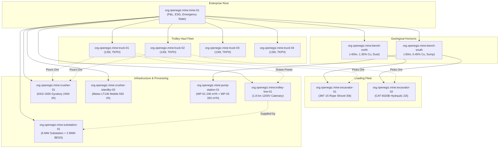

# Eclipse Ditto Digital Twin Ontology & Property Graph
## Цифрлық қос модельдер онтологиясы және байланыс графы (org.openegiz.mine:*)
### Team-018: Smart-Kenish 4.0 Digital Mine Platform

---

## 1. Domain Ontology Overview

The Smart-Kenish 4.0 Digital Mine is modeled as an interconnected property graph inside Eclipse Ditto. All entities reside under the official competition namespace `org.openegiz.mine:*` with deterministic `default:basic_policy` access controls.



---

## 2. Comprehensive 14-Twin Catalog & Schema Specification

### 2.1. `org.openegiz.mine:mine-01` (Enterprise Master)
- **Role:** Central enterprise aggregator for production accounting, P&L economics, ESG decarbonization, and mine safety levels.
- **Attributes:**
  - `name`: "Smart-Kenish Aktau Polymetallic Open-Pit Mine"
  - `kind`: "mine"
  - `annual_capacity_mt`: `12.0` (Mt/year)
  - `deposit_type`: "Copper-Porphyry"
  - `target_grade_pct`: `0.85` (% Cu)
  - `downtime_cost_per_hour_usd`: `111000.0` ($/h)
- **Dynamic Features:**
  - `tonnes_mined`: Cumulative mined rock mass (`t`, float)
  - `avg_grade`: Concentrator feed copper content (`% Cu`, float)
  - `trucks_active`: Active operational trucks count (`units`, integer)
  - `opex_per_tonne`: Real-time operational cost (`$/t`, float)
  - `daily_savings_usd`: Cumulative savings from trolley & blending (`$`, float)
  - `co2_avoided_kg`: Carbon dioxide emissions displaced (`kg CO2`, float)
  - `emergency_level`: Site status enum (`NORMAL`, `ALERT`, `EMERGENCY`)
  - `hourly_risk_exposure_usd`: Active unmitigated risk metric (`$/h`, float)

### 2.2. `org.openegiz.mine:bench-north` (North Geological Horizon)
- **Role:** High-grade chalcopyrite face at elevation +60m.
- **Parent:** `org.openegiz.mine:mine-01`
- **Attributes:** `elevation_m: 60.0`, `strike_azimuth_deg: 45.0`, `bench_height_m: 15.0`.
- **Dynamic Features:**
  - `face_grade`: Local bench copper grade (nominal `1.35% Cu`)
  - `dust_pm10`: Atmospheric dust concentration (`mg/m³`)
  - `seismic_ppv`: Blast vibration peak particle velocity (`mm/s`)

### 2.3. `org.openegiz.mine:bench-south` (South Geological Horizon)
- **Role:** Deep pit bench at elevation -60m containing low-grade ore and the drainage sump.
- **Parent:** `org.openegiz.mine:mine-01`
- **Attributes:** `elevation_m: -60.0`, `sump_capacity_m3: 15000.0`.
- **Dynamic Features:**
  - `face_grade`: Local bench copper grade (nominal `0.45% Cu`)
  - `water_table_m`: Pit bottom water elevation relative to datum (`m`)

### 2.4. `org.openegiz.mine:excavator-01` (Heavy Rope Shovel)
- **Role:** Primary extraction unit on North Bench (+60m).
- **Parent:** `org.openegiz.mine:bench-north`
- **Attributes:** `model: "ЭКГ-15"`, `bucket_volume_m3: 15.0`, `bucket_payload_t: 30.0`, `cycle_time_s: 28.0`.
- **Dynamic Features:**
  - `state`: Operation status (`loading`, `idle`, `moving`)
  - `hourly_production_t`: Real-time digging rate (`t/h`)
  - `assigned_truck`: Current haul truck ID under bucket

### 2.5. `org.openegiz.mine:excavator-02` (Hydraulic Excavator)
- **Role:** Flexible loading unit on South Bench (-60m).
- **Parent:** `org.openegiz.mine:bench-south`
- **Attributes:** `model: "Caterpillar 6020B"`, `bucket_volume_m3: 12.0`, `bucket_payload_t: 22.0`, `cycle_time_s: 25.0`.
- **Dynamic Features:**
  - `state`: Operation status (`loading`, `idle`, `evacuating`)
  - `hourly_production_t`: Real-time digging rate (`t/h`)
  - `evacuation_status`: Status during water inrush (`SAFE_AT_BENCH`, `EVACUATING`, `EVACUATED_AT_ZERO_DATUM`)

### 2.6. `org.openegiz.mine:truck-01`..`04` (BelAZ-75131 Fleet)
- **Role:** 130-tonne trolley-assist autonomous haul fleet.
- **Parent:** `org.openegiz.mine:mine-01`
- **Attributes:**
  - `model`: "БЕЛАЗ-75131"
  - `empty_weight_t`: `107.0`
  - `rated_payload_t`: `130.0`
  - `engine_power_kw`: `1194.0` (Cummins QSK45)
  - `trolley_inverter_power_kw`: `1800.0`
  - `tire_spec`: "Bridgestone 33.00R51 VRDP E-4"
  - `nominal_tkph`: `220.0`
- **Dynamic Features:**
  - `route_position_km`: Location along 0.0 - 3.6 km haul artery (`km`)
  - `speed_kmh`: Velocity (`km/h`)
  - `state`: Cycle mode (`loading`, `hauling_diesel`, `hauling_electric`, `dumping`, `returning_regen`, `breakdown`)
  - `payload_t`: Carried ore mass (`t`)
  - `catenary_connected`: Pantograph engagement status (`true`/`false`)
  - `fuel_rate_lh`: Instantaneous diesel consumption (`l/h`)
  - `tkph`: Operating Ton-Km/h rating
  - `tire_temp_c`: Internal tire carcass temperature (`°C`)
  - `co2_rate_kgh`: Emissions rate (`kg/h`)

### 2.7. `org.openegiz.mine:trolley-line-01` (Overhead Catenary System)
- **Role:** 1.8 km DC catenary power infrastructure installed on the 8.5% continuous ramp (0.6 - 2.4 km).
- **Parent:** `org.openegiz.mine:mine-01`
- **Attributes:** `length_km: 1.8`, `nominal_voltage_v: 1200.0`, `max_current_a: 5000.0`.
- **Dynamic Features:**
  - `state`: Electrical status (`NORMAL`, `OVERLOAD`, `FAULT`)
  - `voltage_v`: Measured contact line voltage (`V`)
  - `current_a`: Total current draw (`A`)
  - `power_delivered_kw`: Real-time electric power supplied to climbing fleet (`kW`)
  - `trucks_connected`: Count of trucks with raised pantographs (`units`)

### 2.8. `org.openegiz.mine:crusher-01` (Primary Gyratory Crusher)
- **Role:** Main run-of-mine size reduction facility discharging directly to the mill feed conveyor.
- **Parent:** `org.openegiz.mine:mine-01`
- **Attributes:** `model: "ККД-1500/180"`, `rated_capacity_th: 2400.0`, `motor_power_kw: 400.0`, `closed_side_setting_mm: 180.0`.
- **Dynamic Features:**
  - `state`: Operating status (`RUNNING`, `HYDRAULIC_RELIEF`, `TRIPPED`, `JAMMED`)
  - `throughput_th`: Real-time crushing rate (`t/h`)
  - `power_draw_kw`: Motor active load (`kW`)
  - `feed_grade_cu`: Weighted average copper content in bowl (`% Cu`)
  - `metal_detector_trip`: Tramp iron sensor trip flag (`true`/`false`)
  - `mantle_relief_pos_mm`: Hydro-set hydraulic piston position (`mm`)

### 2.9. `org.openegiz.mine:crusher-standby-02` (Standby Mobile Jaw Unit)
- **Role:** Emergency mobile comminution unit deployed during primary gyratory outages.
- **Parent:** `org.openegiz.mine:mine-01`
- **Attributes:** `model: "Metso Lokotrack LT140"`, `capacity_th: 550.0`, `diesel_engine_kw: 310.0`.
- **Dynamic Features:**
  - `state`: Ready status (`STANDBY`, `AUTO_STARTING`, `RUNNING_ONLINE`)
  - `throughput_th`: Instantaneous throughput (`t/h`)

### 2.10. `org.openegiz.mine:pump-station-01` (Pit Dewatering Complex)
- **Role:** Deep bench drainage sump pumping station with automatic transfer switch (ATS).
- **Parent:** `org.openegiz.mine:bench-south`
- **Attributes:** `sump_max_depth_m: 6.0`, `high_water_alarm_m: 2.5`.
- **Dynamic Features:**
  - `water_level_m`: Current sump water level above pump datum (`m`)
  - `inflow_rate_m3h`: Measured groundwater and runoff inflow rate (`m³/h`)
  - `pump1_rate_m3h`: Main centrifugal pump WP-01 flow (`m³/h`)
  - `pump2_rate_m3h`: Emergency pontoon submersible slurry pump WP-02 flow (`m³/h`)
  - `contingency_status`: Inrush response level (`NORMAL`, `SURGE_DRAIN`, `EMERGENCY_ATS_ACTIVE`)

### 2.11. `org.openegiz.mine:substation-01` (Traction Substation & BESS Microgrid)
- **Role:** 6 MW substation providing regulated 1200V DC power and managing the 2 MWh peak-shaving battery.
- **Parent:** `org.openegiz.mine:mine-01`
- **Attributes:** `transformer_rating_mva: 6.3`, `bess_capacity_kwh: 2000.0`, `bess_max_power_kw: 1500.0`.
- **Dynamic Features:**
  - `grid_status`: AC utility intertie state (`NORMAL`, `PEAK_SHAVING`, `ISLANDED`)
  - `bess_soc_pct`: Battery state of charge (`%`, nominal operating window 10–95%)
  - `bess_power_kw`: Battery active power flow (`+kW` discharging / `-kW` charging from regen)
  - `grid_power_kw`: Utility intertie active power draw (`kW`)

---

## 3. Protocol Contracts & Ingestion Mapping

All simulator updates are formatted according to the **Eclipse Ditto Protocol Specification v2** and published over MQTT 3.1.1:

```json
{
  "topic": "org.openegiz.mine/truck-01/things/twin/commands/modify",
  "headers": {
    "content-type": "application/json"
  },
  "path": "/features",
  "value": {
    "motion": {
      "properties": {
        "speed": 24.5,
        "position": 1.45,
        "payload": 130.0
      }
    },
    "catenary": {
      "properties": {
        "connected": true,
        "voltage": 1185.0
      }
    },
    "tires": {
      "properties": {
        "tkph": 175.5,
        "temperature": 63.8
      }
    }
  }
}
```

This strict JSON structure guarantees that Telegraf parses each property into InfluxDB tagged with `thingId="org.openegiz.mine:truck-01"` and `parent="org.openegiz.mine:mine-01"`, feeding Grafana Flux queries deterministically.
